

<picture><source media="(prefers-color-scheme: dark)" srcset="assets/banner-dark.svg"></picture>

  

<a href="./CV_Francu_Leonardo_Cosmin.pdf"><picture><source media="(prefers-color-scheme: dark)" srcset="assets/btn-cv-dark.svg"></picture></a>
<a href="https://www.linkedin.com/in/leonardofrancu"><picture><source media="(prefers-color-scheme: dark)" srcset="assets/btn-linkedin-dark.svg"></picture></a>
<a href="mailto:leonardocfrancu@gmail.com"><picture><source media="(prefers-color-scheme: dark)" srcset="assets/btn-email-dark.svg"></picture></a>

 

<b>English</b> &nbsp;·&nbsp; <a href="#versione-italiana">Versione italiana</a>

 

### About me

What I enjoy most is taking large, messy, real-world data and finding the patterns that explain what's going on in it.

I've recently started as an **Inventory Data Analyst Intern at Faiveley Transport**, a Wabtec company, where I get to do exactly that with real operational data.

I'm a final-year Computer Science student at the Università degli Studi di Torino, graduating in November 2026, and my thesis is where this shows most clearly. Through a research project approved by Meta, I worked with the Meta Content Library on more than 500,000 posts from Facebook groups, studying how people respond emotionally during emergencies and how that response changes with what a post says, when it is published and how much warning people had.

My coursework has followed the same thread: relational database design, statistical analysis at scale, distributed systems, and software engineering methodology. My long-term goal is to specialize technically in data analysis.

 

<picture><source media="(prefers-color-scheme: dark)" srcset="assets/experience-en-dark.svg">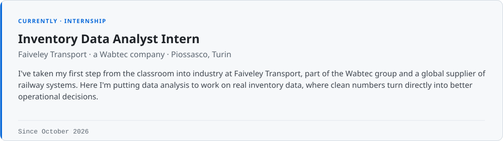</picture>

  

<a href="https://github.com/leofrancu/tesi-gruppi-facebook-emergenze"><picture><source media="(prefers-color-scheme: dark)" srcset="assets/thesis-en-dark.svg">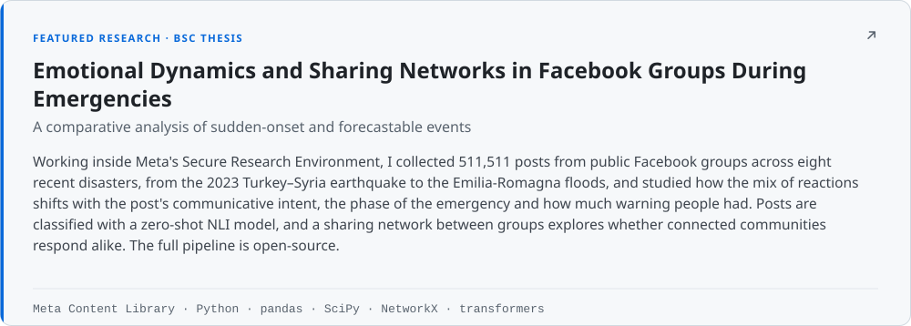</picture></a>

### Selected projects

<a href="https://github.com/leofrancu/UniTo-IUM-TWEB-2024-25"><picture><source media="(prefers-color-scheme: dark)" srcset="assets/card-ium-tweb-en-dark.svg">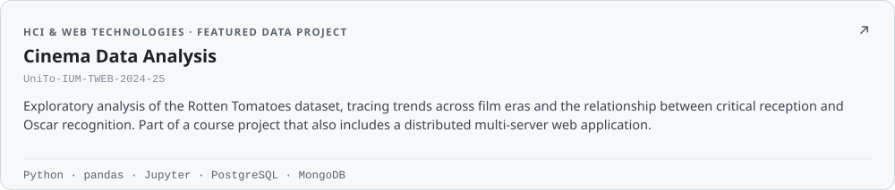</picture></a>

<a href="https://github.com/leofrancu/UniTo-BD-2023-24"><picture><source media="(prefers-color-scheme: dark)" srcset="assets/card-bd-en-dark.svg">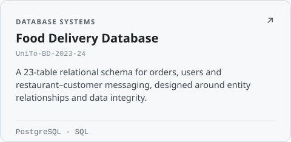</picture></a>
<a href="https://github.com/leofrancu/Unito-SAS-2025-26"><picture><source media="(prefers-color-scheme: dark)" srcset="assets/card-sas-en-dark.svg">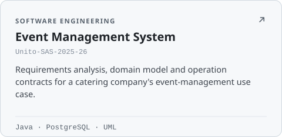</picture></a>

<a href="https://github.com/leofrancu/UniTo-ProgIII-2025-26"><picture><source media="(prefers-color-scheme: dark)" srcset="assets/card-prog3-en-dark.svg">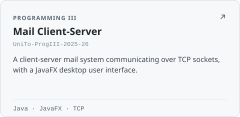</picture></a>
<a href="https://github.com/leofrancu/UniTo-LFT-2023-24"><picture><source media="(prefers-color-scheme: dark)" srcset="assets/card-lft-en-dark.svg">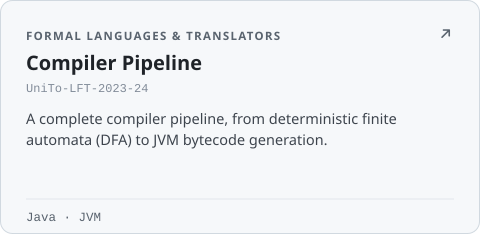</picture></a>

<picture><source media="(prefers-color-scheme: dark)" srcset="assets/card-asd-en-dark.svg">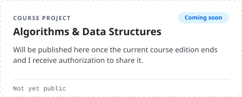</picture>
<picture><source media="(prefers-color-scheme: dark)" srcset="assets/card-so-en-dark.svg">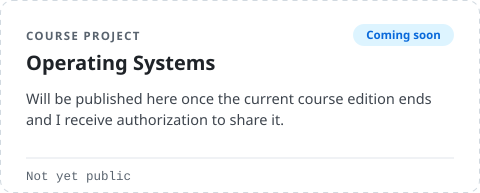</picture>

 

<picture><source media="(prefers-color-scheme: dark)" srcset="assets/skills-en-dark.svg">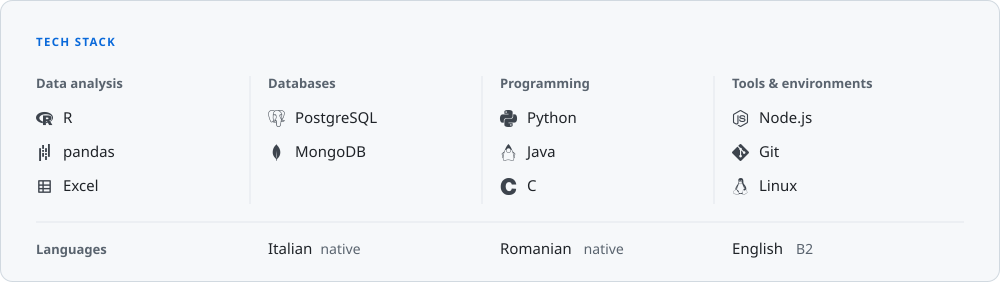</picture>

 

<picture><source media="(prefers-color-scheme: dark)" srcset="assets/education-en-dark.svg">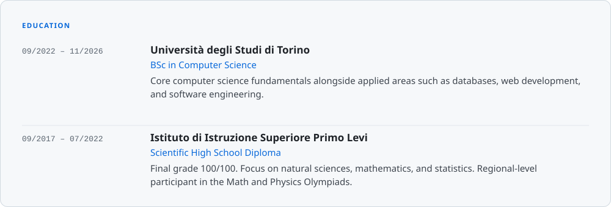</picture>

 

## Versione italiana

<b>Mostra il profilo in italiano</b>

 

### Chi sono

Quello che mi appassiona di più è prendere dati reali, grandi e disordinati, e trovare i pattern che spiegano cosa sta succedendo.

Ho da poco iniziato un tirocinio come **Inventory Data Analyst Intern in Faiveley Transport**, azienda del gruppo Wabtec, dove posso fare proprio questo su dati operativi reali.

Sono un laureando in Informatica all'Università degli Studi di Torino, mi laureo a novembre 2026, e la mia tesi è dove questa passione si vede meglio. Grazie a un progetto di ricerca approvato da Meta, ho lavorato con la Meta Content Library su oltre 500.000 post di gruppi Facebook, studiando come le persone reagiscono emotivamente durante le emergenze e come questa risposta cambia in base a cosa dice un post, a quando viene pubblicato e al preavviso di cui la popolazione ha disposto.

Il mio percorso universitario ha seguito lo stesso filo: progettazione di database relazionali, analisi statistica su larga scala, sistemi distribuiti e metodologia di ingegneria del software. Il mio obiettivo di lungo periodo è specializzarmi tecnicamente nell'analisi dei dati.

 

<picture><source media="(prefers-color-scheme: dark)" srcset="assets/experience-it-dark.svg">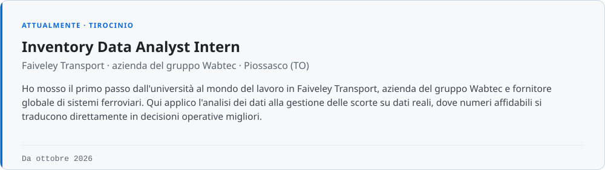</picture>

  

<a href="https://github.com/leofrancu/tesi-gruppi-facebook-emergenze"><picture><source media="(prefers-color-scheme: dark)" srcset="assets/thesis-it-dark.svg"></picture></a>

### Progetti selezionati

<a href="https://github.com/leofrancu/UniTo-IUM-TWEB-2024-25"><picture><source media="(prefers-color-scheme: dark)" srcset="assets/card-ium-tweb-it-dark.svg">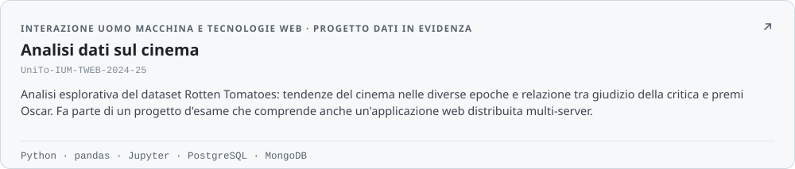</picture></a>

<a href="https://github.com/leofrancu/UniTo-BD-2023-24"><picture><source media="(prefers-color-scheme: dark)" srcset="assets/card-bd-it-dark.svg">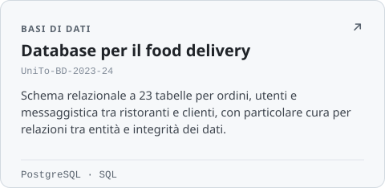</picture></a>
<a href="https://github.com/leofrancu/Unito-SAS-2025-26"><picture><source media="(prefers-color-scheme: dark)" srcset="assets/card-sas-it-dark.svg">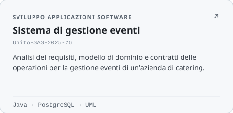</picture></a>

<a href="https://github.com/leofrancu/UniTo-ProgIII-2025-26"><picture><source media="(prefers-color-scheme: dark)" srcset="assets/card-prog3-it-dark.svg">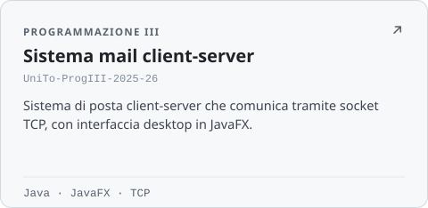</picture></a>
<a href="https://github.com/leofrancu/UniTo-LFT-2023-24"><picture><source media="(prefers-color-scheme: dark)" srcset="assets/card-lft-it-dark.svg">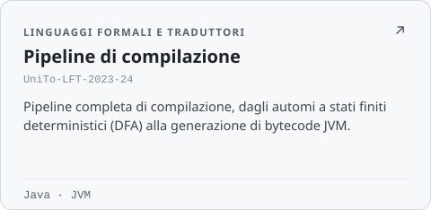</picture></a>

<picture><source media="(prefers-color-scheme: dark)" srcset="assets/card-asd-it-dark.svg">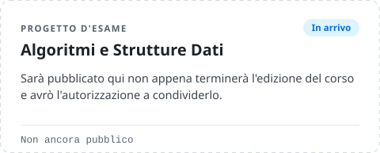</picture>
<picture><source media="(prefers-color-scheme: dark)" srcset="assets/card-so-it-dark.svg">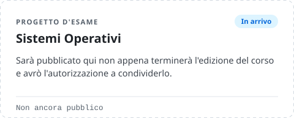</picture>

 

<picture><source media="(prefers-color-scheme: dark)" srcset="assets/skills-it-dark.svg">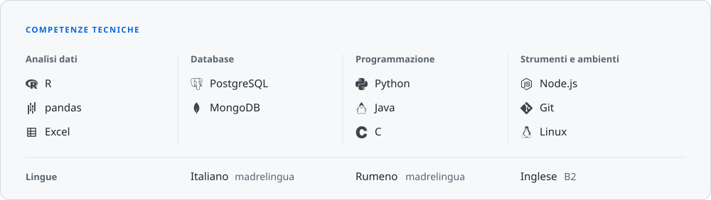</picture>

 

<picture><source media="(prefers-color-scheme: dark)" srcset="assets/education-it-dark.svg">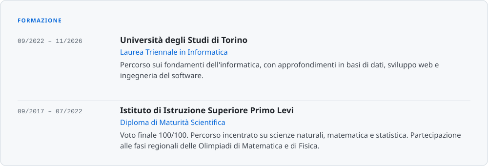</picture>

